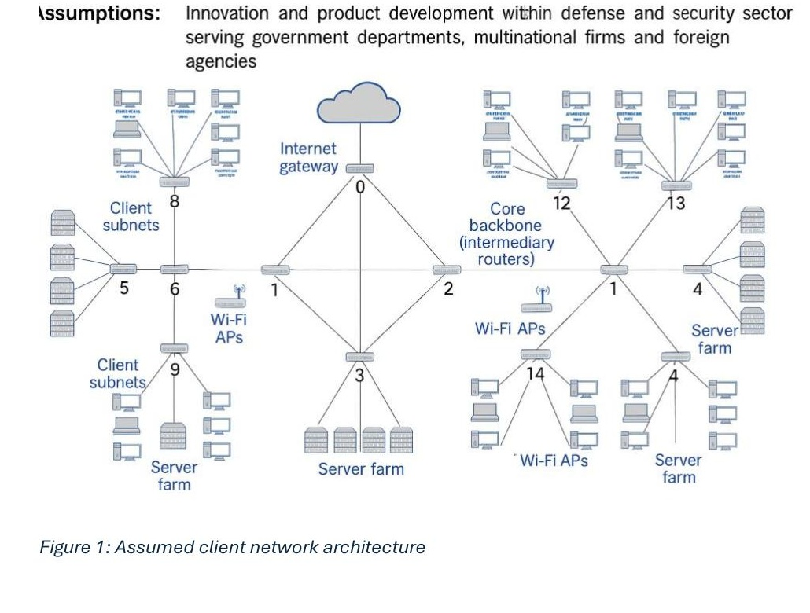
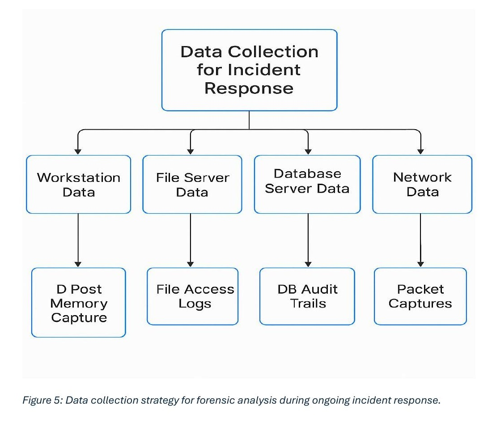
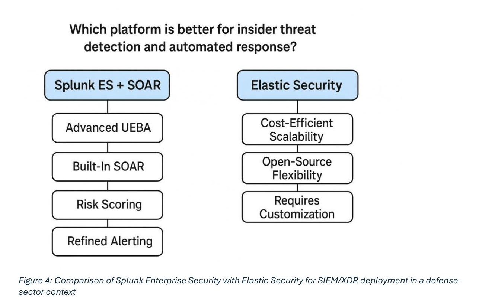
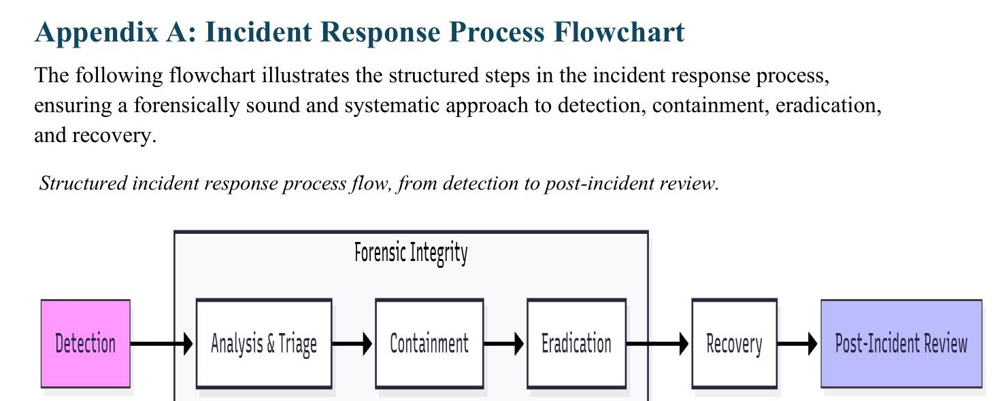
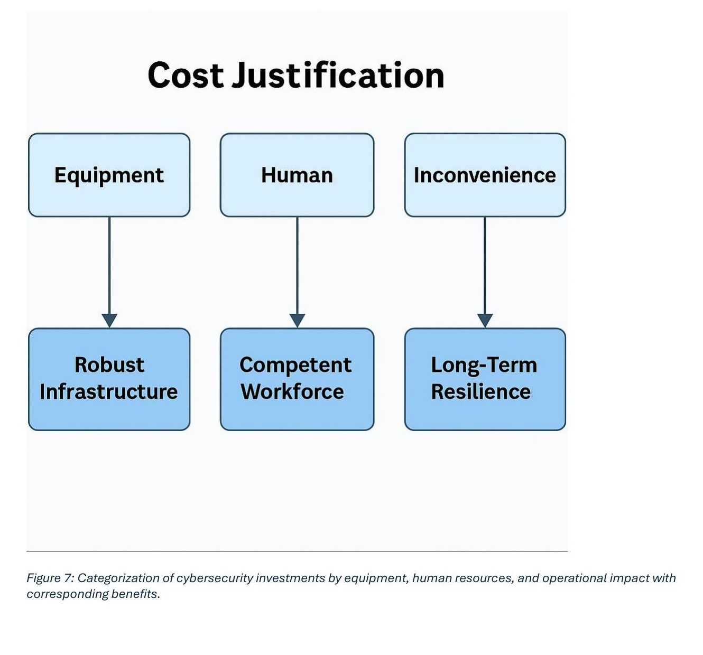

# Incident Response: Insider Threat Detection & Forensic Data Collection Strategy

## What this project is about

The task was to advise a client in the defense/security sector on how to detect insider-threat reconnaissance, build out a forensically sound data collection strategy, choose between SIEM platforms, and be ready to run a real incident response if an insider tried to exfiltrate data. This wasn't a hands-on build, it's a written strategy and set of recommendations, the kind of report you'd hand to a client before deploying anything.

The assumed client operates in defense/security product development, serving government departments, multinational firms and foreign agencies, which makes them a high-value target for both insider threats and advanced persistent threats. I worked from an assumed network spanning multiple client subnets, Wi-Fi access points, server farms and a core backbone behind a single internet gateway.

## Detecting insider-threat reconnaissance

Before someone exfiltrates data, they're usually probing around first, so I looked at what distinguishes that from normal activity: unusual changes in access patterns, off-hours authentication, data getting staged somewhere it shouldn't be. I mapped out which log sources catch this early (authentication logs, DLP alerts, endpoint telemetry, file-access auditing) rather than finding out after the fact.

## Data collection strategy for forensic analysis

I worked through what to collect, from where, and why, while balancing investigative value against how much disruption it causes operationally. Forensic integrity mattered a lot here: chain of custody, order of volatility, not contaminating evidence while collecting it.

## SIEM platform comparison: Splunk vs Elastic Stack

Splunk Enterprise Security plus SOAR went up against Elastic Security here, judged specifically on insider-threat detection and automated response, and weighed on cost, scalability, automation capability and how easy each is to run day to day.

| Feature | Splunk | Elastic Stack |
|---|---|---|
| Deployment Type | Commercial, enterprise-managed solution | Open-source, highly customizable |
| Cost | Higher (subscription-based licensing) | Lower (open-source with optional support) |
| Automation & SOAR | Integrated automation and orchestration features | Customizable via plugins and scripts |
| Scalability | Excellent for enterprise-scale environments | Highly scalable with modular components |
| Ease of Use | User-friendly dashboards, prebuilt content | Requires expertise for full customization |

## Incident response exercise: insider-led data exfiltration

This section runs a hypothetical insider-led exfiltration incident end to end: which forensic data sources you'd need, where the gaps in existing visibility would be, and how to collect evidence in a way that holds up (write-blocking, hashing, a documented chain of custody). It also covers how the response would change if what looked like one insider turned out to be part of a broader APT campaign.

## Cost-effectiveness analysis

The recommended investment is justified across equipment, people, and operational impact, weighing upfront cost against the long-term reduction in breach risk.

| Category | Investment | Benefit |
|---|---|---|
| Hardware | Sensors, packet capture devices, storage appliances | Improved visibility and forensic capability |
| Software | SIEM licenses, endpoint monitoring agents | Enhanced threat detection and log correlation |
| Human Resources | Analyst training, certifications | Skilled workforce for efficient incident response |
| Operational Impact | Temporary disruptions during implementation | Long-term resilience and reduced breach risk |

## Topics covered

Insider threat detection, forensic readiness, chain of custody, SIEM/SOAR platform evaluation (Splunk Enterprise Security, Elastic Security), the incident response lifecycle (detection, analysis & triage, containment, eradication, recovery, post-incident review), APT considerations, cost-benefit analysis for security investment.

## Evidence

Full-size versions of all figures and supporting tables (including the Appendix B and C tables) are in [`figures/`](./figures).

## Disclaimer

This report is based on an assumed client scenario. It doesn't describe a real organisation's network or an actual incident.
